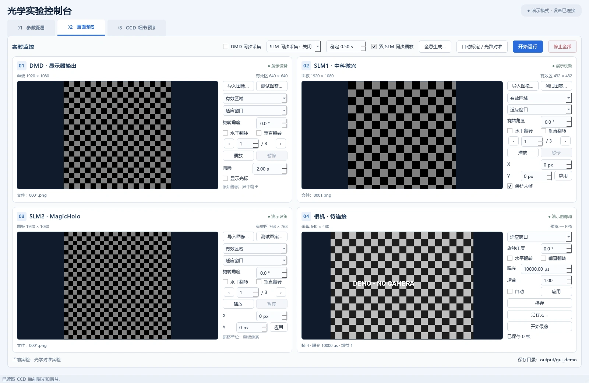

# Qing · 光学实验控制台

用于 DMD 输入、单／双 SLM 相位显示和相机采集的 Windows Qt 工具，提供光路对准、全息生成及模型标定入口。

[作者 GitHub：MrBear9](https://github.com/MrBear9) · [项目仓库](https://github.com/MrBear9/Multi_SLM_DMD) · [版本下载](https://github.com/MrBear9/Multi_SLM_DMD/releases)



*上图为 demo 模式：使用棋盘格和模拟相机图像，不连接真实硬件。*

## UI 与功能

- **参数配置**：设备选择、SDK 路径、输入与保存目录、设备枚举及配置保存。
- **画面预览**：DMD 与 SLM 图像导入、测试图案、序列播放、旋转翻转，以及相机曝光、保存、另存为和录像。
- **CCD 细节预览**：1∶1 查看、缩放平移、冻结画面、ROI 标注和采集保存。
- **自动标定／光路对准**：导入相位包并执行相机反馈对准；开发环境可训练相位。
- **全息生成与模型标定**：支持单／双 SLM 模式，提供目标尺寸、几何映射与 ROI、离线优化和相机回环设置。训练在外部 Python 环境运行。

## 支持设备

| 类型 | 接入方式 |
| --- | --- |
| DMD | 显示器输出或 F4321 网络控制器 |
| SLM1 | 中科微兴 SDK |
| SLM2 | MagicHolo HDSLM SDK |
| 相机 | DVP2 或 ToupTek SDK |

按实际实验启用所需设备。Windows 显示器编号与 SLM SDK 的设备 ID 不一定相同，连接前请先枚举核对。

## 快速启动

以下命令均在本子项目目录（`tools`）执行，建议使用 **Windows x64、Python 3.10+**。

```powershell
python -m pip install -r requirements-gui.txt

# 演示模式，无需硬件
python .\apps\optical_control.py --demo

# 连接真实设备
python .\apps\optical_control.py
```

真实设备需要对应驱动、厂商 SDK 和运行库，SDK 放在 `3rdparty/` 下。进入程序后，在第一页配置并连接设备，再到第二页操作预览与采集。

运行下载的打包版时，完整解压 ZIP 后启动 `Qing.exe`，保留同目录的 `lib/`。

## 打包

准备好依赖及 `3rdparty/` 中所需的 SDK 文件后，在本目录执行：

```powershell
python -m PyInstaller --noconfirm --clean Qing.spec
```

产物位于 `dist/Qing/`。发布时压缩整个文件夹，上传到 GitHub Release 附件。

## 文档与开发

| 内容 | 入口 |
| --- | --- |
| UI 操作、硬件配置与采集说明 | [UI 使用说明](ui/README.md) |
| DMD＋双 SLM 自动标定 | [自动标定说明](calibration/README.md) |
| 全息训练、相机回环与几何标定 | [全息模块说明](holography/README.md) |

主要目录：`apps/` 为启动入口，`gui/` 为界面逻辑，`ui/` 为可用 Qt Designer 编辑的界面文件，`devices/` 为硬件适配，`calibration/` 与 `holography/` 为标定和全息模块。

全息及相位训练的依赖分别见 `holography/requirements.txt`、`calibration/requirements.txt`；主界面运行不要求安装 PyTorch。

**实验提示：**界面中的同步播放是软件调度，不等同于硬件同步触发。几何映射、灰度—相位响应及重建效果仍需结合实际光路验证。
